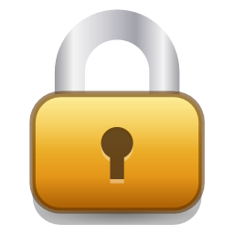
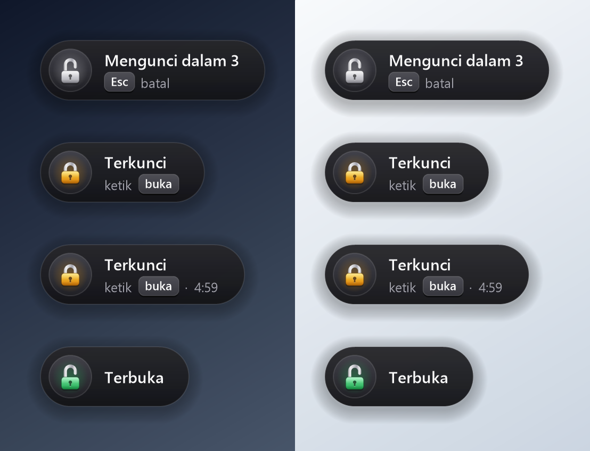

<p align="center">
  
</p>

<h1 align="center">Kunci Keyboard</h1>

<p align="center">
  Kunci keyboard, mouse, touchpad, dan layar sentuh laptop Windows dengan satu pintasan.<br>
  Layar tetap menyala, video tetap jalan.
</p>

## Kenapa dibuat

Nonton kartun bareng anak kecil di laptop itu jarang tenang. Baru beberapa menit, tangannya sudah ke keyboard. Video berhenti karena spasi kepencet, layar penuh keluar karena Esc, tab tertutup, aplikasi berpindah, volume naik turun, kadang malah mengetik di dokumen yang masih terbuka. Touchpad juga ikut jadi mainan.

Pilihan yang ada tidak ada yang pas:

- Menutup laptop berarti videonya ikut mati.
- Keyboard laptop tidak bisa dicabut.
- `Win+L` mengunci Windows, tapi layarnya ikut tertutup.
- Windows tidak punya fitur bawaan untuk mengunci input sambil tetap memperlihatkan layar.

Kunci Keyboard mengisi celah itu. Tekan `Ctrl+Alt+K`, tiga detik kemudian semua input terkunci. Videonya tetap jalan, dan anak boleh memencet apa saja tanpa terjadi apa-apa. Selesai nonton, ketik `buka` dan laptop normal lagi.

<p align="center">
  
</p>

Lencana kecil di bawah layar hanya muncul sebentar saat ada tombol atau sentuhan, lalu memudar sendiri supaya tidak menutupi video.

## Cara pakai

1. Unduh `KunciKeyboard.exe` dari halaman [Releases](../../releases), atau build sendiri (lihat di bawah).
2. Jalankan. Ada hitung mundur 3 detik, dan `Esc` selama hitung mundur membatalkan.
3. Sesudah terkunci, ketik `buka` untuk membuka.

Exe ini belum ditandatangani, jadi Windows SmartScreen mungkin memperingatkan saat pertama dibuka. Pilih **More info** lalu **Run anyway**.

Pilihan tambahan:

```
KunciKeyboard.exe --kata rahasia     kata pembuka sendiri (huruf/angka, 2 sampai 20 karakter)
KunciKeyboard.exe --menit 30         buka otomatis sesudah 30 menit
```

### Pintasan Ctrl+Alt+K

1. Klik kanan `KunciKeyboard.exe`, pilih **Show more options**, **Send to**, **Desktop (create shortcut)**.
2. Klik kanan pintasan itu, pilih **Properties**.
3. Klik kolom **Shortcut key**, tekan `K`. Hasilnya `Ctrl + Alt + K`.

Pintasan keyboard hanya berlaku untuk shortcut yang ada di Desktop atau Start Menu.

### Mode admin (disarankan)

Tanpa mode admin, jendela yang berjalan sebagai administrator (Task Manager, installer, terminal admin, sebagian launcher game) tidak ikut terkunci. Windows memang tidak meneruskan tombol untuk jendela admin ke aplikasi biasa.

```
KunciKeyboard.exe --pasang     pasang sekali, minta izin UAC satu kali
KunciKeyboard.exe --copot      lepas lagi
```

`--pasang` menyalin exe ke `C:\Program Files\KunciKeyboard` dan mendaftarkan tugas terjadwal `KunciKeyboard` dengan hak tertinggi. Sesudah itu, setiap kali exe biasa dijalankan, penguncian diserahkan ke tugas tersebut tanpa UAC lagi. Folder Program Files hanya bisa diubah admin, jadi tugas itu tidak bisa dibelokkan ke program lain. Dari luar, salinan admin hanya menerima kata pembuka dan menit.

Sesudah memperbarui exe, jalankan `--pasang` lagi supaya salinan di Program Files ikut baru.

### Kalau lupa kata pembuka

Tekan `Ctrl+Alt+Del`. Windows tidak mengizinkan kombinasi ini diblokir, dan begitu layar `Ctrl+Alt+Del` muncul, kunci langsung terbuka. Tekan `Esc` untuk kembali. Hal yang sama terjadi saat `Win+L` atau layar UAC muncul.

## Yang tidak bisa dikunci

- `Ctrl+Alt+Del` dan `Win+L`, karena ditangani langsung oleh Windows. Keduanya sengaja dijadikan jalan keluar.
- Gestur touchpad tiga atau empat jari dan usapan dari tepi layar sentuh. Gestur ini diproses Windows tanpa lewat jalur mouse biasa.
- Tombol Fn untuk kecerahan atau mode pesawat, yang diproses langsung oleh hardware laptop.

## Cara kerja

- **Keyboard dan mouse/touchpad** ditahan dengan hook tingkat rendah Windows (`WH_KEYBOARD_LL` dan `WH_MOUSE_LL`). Tombol yang sudah ditekan sebelum terkunci tetap boleh dilepas, supaya tidak ada tombol yang nyangkut.
- **Layar sentuh** ditahan oleh jendela tembus pandang selebar semua monitor yang menelan sentuhan, sementara isi layar tetap terlihat.
- **Hook punya thread sendiri** dengan prioritas tertinggi dan tidak mengerjakan hal lain. Hook yang telat menjawab dilewati oleh Windows, dan kalau berulang dicabut diam-diam. Di versi pertama hook masih satu thread dengan tampilan, jadi kadang ada tombol yang lolos. Sekarang hook juga dipasang ulang tiap detik, sehingga selalu dipanggil paling awal, mendahului aplikasi lain yang memasang hook serupa.
- **Kalau terjadi galat**, input tetap diblokir, bukan malah dilepas. Kata pembuka dan buka otomatis tetap berfungsi walaupun tampilan bermasalah.
- **Catatan kejadian** (kapan terkunci, terbuka karena apa, jendela yang fokusnya tidak bisa diambil) tersimpan di `%LOCALAPPDATA%\KunciKeyboard\catatan.txt`.

## Build

Tidak perlu memasang apa pun. Cukup compiler C# bawaan .NET Framework 4 yang sudah ada di Windows 10 dan 11:

```
build.cmd
```

Hasilnya `KunciKeyboard.exe` di folder yang sama. Seluruh kode ada di satu berkas, `KunciKeyboard.cs`.

Untuk menguji tanpa benar-benar mengunci input:

```
KunciKeyboard.exe --uji folder-hasil
```

Mode ini menjalankan thread hook beberapa detik tanpa memblokir apa pun, menulis laporan ke `hook.txt`, lalu menggambar semua keadaan lencana ke PNG.

## English

Kunci Keyboard ("keyboard lock") locks the keyboard, mouse, touchpad, and touchscreen of a Windows laptop while the screen stays on, so a video keeps playing while a small child mashes the keys. Press `Ctrl+Alt+K`, wait three seconds, and type `buka` to unlock. `Ctrl+Alt+Del` always unlocks as an escape hatch. Run `--pasang` once to install admin mode, so that elevated windows are locked too. Build with `build.cmd`. No install is needed; it uses the C# compiler that ships with Windows.
